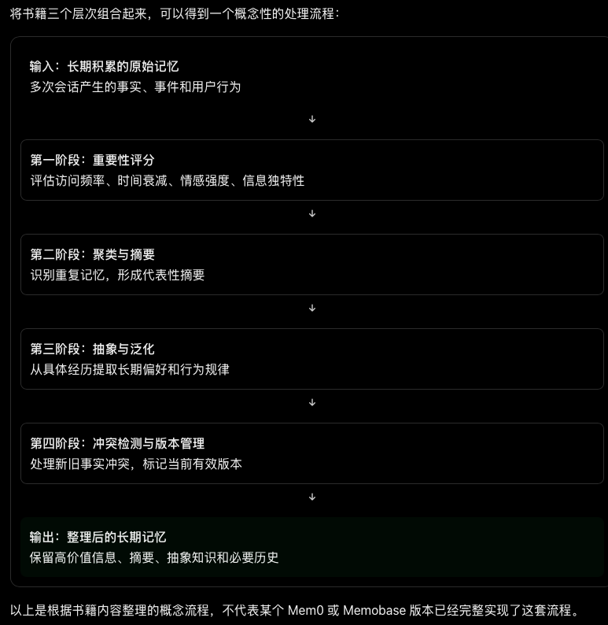

Mem0 和 Memobase 都是为 AI Agent 提供长期记忆能力的方案，解决的问题相同：让 Agent 不只是记住当前对话，还能够跨多轮、跨会话保留和使用用户信息。
# 一、Mem0
Mem0 的核心思路是：将对话内容交给模型分析，提取值得长期保存的信息，再将记忆向量化并持久化，供后续检索和管理。

| 技术            | 作用                     | 技术               |
|-----------------|--------------------------|--------------------|
| LLM 大语言模型  | 从对话中提取、归纳记忆   | DeepSeek API       |
| Embedding       | 将文本转换为向量         | Qwen3 Embedding 4B |
| Ollama          | 本地运行模型             | Ollama             |
| Vector Database | 保存向量并进行相似度检索 | ChromaDB           |
| RAG 检索思想    | 根据语义召回相关记忆     | Mem0 search        |
| Python SDK      | 调用记忆管理接口         | mem0ai             |
| HTTP API        | 连接远程模型服务         | OpenAI 兼容接口    |

## 适用场景
- 个人 AI 助手:记住用户的职业、技术偏好、兴趣和习惯，让多次对话具有连续性
- 智能客服:记住客户历史问题、产品偏好和服务记录，减少重复询问。
- AI 编程助手:记住项目技术栈、开发规范、用户编码习惯，辅助后续开发。
- 企业业务 Agent:保存用户与业务交互过程中产生的长期信息，为后续任务提供上下文。
## 适合 Mem0 的典型特征：
- 记忆内容是动态产生的。
- 记忆数量较多，适合按语义召回。
- 用户信息会随交互不断变化。
- 需要对记忆进行独立的增删改查。

# 二、memobase
Memobase 更强调将对话信息整理为结构化的用户记忆，而不只是保存一条条独立的文本向量。
更关注用户长期信息的组织和管理。 它不是只保存一条条独立记忆，而是尝试将用户多次对话中的信息整合为结构化 Profile
我们之前完成的是本地服务部署和 Python SDK 的基础调用验证。

| 技术                      | 作用                 |
|---------------------------|----------------------|
| Python SDK                | 客户端调用           |
| HTTP / REST API	Python     | 客户端与服务端通信   |
| Memobase Server           | 负责服务端记忆处理   |
| ChatBlob                  | 表示和传递对话数据   |
| MemoBaseClient            | 服务连接和接口调用   |
| User Profile              | 用户画像与结构化记忆 |
| 持久化存储                | 保存用户和记忆数据   |

## 适用场景
- AI 个性化教育：管理学习者的基础情况、知识水平、学习进度和学习目标。
- 个性化推荐：管理用户兴趣、消费偏好和长期需求，辅助推荐决策。
- 企业客户管理 Agent：形成客户画像，帮助销售和客服理解客户背景、需求和历史情况。
- 长期个人服务 Agent：组织用户的长期目标、偏好和习惯，为持续服务提供结构化上下文。

## 适合 Memobase 的典型特征：
- 需要长期维护用户画像。
- 用户信息具有明确的结构和分类。
- 不同会话的信息需要不断整合。
- 业务需要直接读取用户属性和偏好。

# 三、Mem0 和 Memobase 的核心区别

| 对比维度      | Mem0               | Memobase                     |
|---------------|--------------------|------------------------------|
| 记忆组织方式  | 独立记忆条目       | 结构化用户画像               |
| 核心对象      | Memory             | User Profile                 |
| 信息组织重点  | 记住哪些重要事实   | 用户整体是什么情况           |
| 信息检索      | 语义检索为重要能力 | Profile 获取及结构化信息使用 |
| 典型应用      | 长期对话记忆       | 用户画像与个性化服务         |
| 设计侧重点    | 记忆生命周期管理   | 用户信息的组织和维护         |

# 四、记忆压缩与整理
## 4.1 三层记忆压缩策略
1. 重要性评分（Importance Scoring）：判断哪些记忆值得保留。

| 因素       | 含义                   | 判断方向           |
|------------|------------------------|--------------------|
| 访问频率   | 记忆被检索的次数       | 越频繁越重要       |
| 时间衰减   | 距离记忆创建的时间     | 越久远越容易遗忘   |
| 情感强度   | 记忆所带有的情感标记   | 情感越强越值得保留 |
| 信息独特性 | 信息是否与其他记忆重复 | 越独特越值得保留   |

2. 聚类与摘要（Clustering & Summarization）:相似记忆如何合并，同时避免丢失必要细节？
3. 抽象与泛化（Abstraction & Generalization）:如何从具体经历中提炼稳定知识和行为规律？
## 4.2 冲突检测与版本化管理
新旧记忆冲突怎么办？
- 保留历史版本。
- 标记最新版本。
- 根据不同信息类型决定历史保留策略。

这背后的关键思想是： 记忆更新不等于简单覆盖，必须考虑事实的有效时间和历史追溯需求。
这也与之前学习 Advanced JSON Cards 时讨论的历史信息保留问题相呼应。
## 4.3 技术应用：整理流程如何运行？

